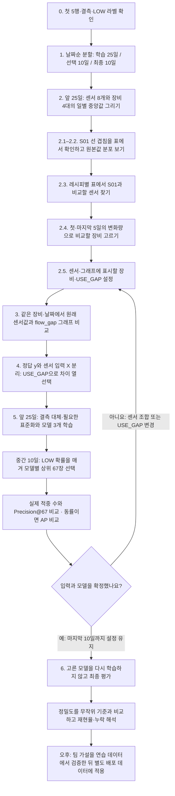

# 해커톤 v2 오전 실습: 센서 변화에서 저수율 판별까지

## 목표와 준비

45분 동안 센서 그래프에서 가설을 만들고, 그 가설이 실제로 검사 대상을 더 잘 고르는 데 도움이 되는지 검증한다. 그래프에서 변화가 보이는 것과 저수율 판별에 도움이 되는 것은 별개다.

[학생용 노트북](v2_학생용_웨이퍼_분석.ipynb)을 열고, GitHub에서 내려받은 [오전 연습용 CSV](해커톤_v2_데이터/data/v2_train_10800.csv)만 Colab의 `/content`에 업로드한다. 처음이라면 [Colab 준비 가이드](docs/colab/README.md)를 따른다. 별도 배포되는 오후용 CSV는 오전에 사용하지 않는다.

## 실습 흐름

| 노트북 번호 | 할 일 | 남길 근거 |
| --- | --- | --- |
| 0–1 | 첫 5행, 결측, 학습 구간의 `LOW` 비율을 확인한다. 10,800장을 날짜순으로 앞 25일(6,000장), 중간 10일(2,400장), 마지막 10일(2,400장)로 나눈다. | 입력과 정답의 구분, 각 구간의 역할 |
| 2 | 센서 8개와 장비 4대의 일별 중앙값을 그린다. 겹친 `S01` 선을 표로 확인한 뒤 원본값과 레시피별 표, 장비별 변화량으로 비교 후보를 고른다. | 센서·장비 선택 근거가 된 표의 수치 |
| 3 | 같은 장비와 날짜에서 원래 센서값과 `flow_gap = S02 - S01` 그래프를 비교한다. | 비교 조건, 가설을 지지하거나 지지하지 않는 관찰 |
| 4 | 웨이퍼별 센서값과 선택한 경우 `flow_gap`으로 입력 `X`를 만든다. 저수율 여부는 정답 `y`로 분리한다. | 표에 표시된 입력 열이 설정과 일치하는지 확인 |
| 5 | 앞 25일로 학습한 로지스틱 회귀·얕은 트리·KNN을 중간 10일에서 비교한다. 같은 모델·센서·날짜를 고정하고 `USE_GAP`만 바꿔 적중 수를 비교할 수 있다. | `hits`, `precision_at_k`, 필요하면 동률 판단에 쓰는 AP |
| 6 | 설정을 확정한 뒤, 다시 학습하지 않고 마지막 10일을 평가한다. | 무작위 기준 대비 정밀도, 재현율과 놓친 장수 |

**검사 기준:** 오후의 3,600장 중 100장이라는 검사 비율을 오전 평가 구간 2,400장에 적용해 67장으로 반올림한다. 확률 0.5를 기준으로 분류하지 않고, 모델이 낸 `LOW` 확률인 `risk`가 높은 순서로 67장을 고른다. 선택되지 않은 웨이퍼를 정상으로 확정한 것은 아니다.

**오후 연결:** 오전의 모델을 그대로 가져가는 것이 목표는 아니다. 정답이 있는 연습 데이터에서 팀의 가설을 비교 검증한 뒤, 확정한 방법을 수율 숨김 데이터에 적용해 제출할 검사 대상을 고른다.