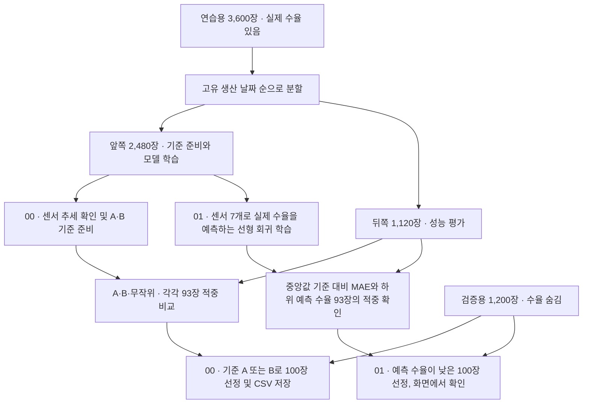

# 인하공전 반도체·AI 해커톤 | 웨이퍼 검사 실습

익명 센서값으로 저수율 웨이퍼를 찾아 우선 검사할 100장을 고르는 Colab 실습입니다. 기초에서는 센서 기반 규칙을 만들고, 심화에서는 선형 회귀가 같은 검사 예산에서 더 유용한지 확인합니다.

## 실습 시작

Colab이 처음이라면 [한국어 화면으로 보는 실행 준비 가이드](docs/colab/README.md)부터 확인하세요.

| 순서 | 노트북·시나리오 | 확인할 결과 |
| --- | --- | --- |
| 00. 기초 (45분) | [기초 노트북](00_wafer_inspection_lab.ipynb) · [연습 시나리오](Colab_연습_시나리오.md) | 센서 추세 확인, A·B·무작위 적중 비교, 검증용 100장 제출 CSV 저장 |
| 01. 심화 (선택, 10~15분) | [심화 노트북](01_wafer_regression_advanced.ipynb) · [심화 시나리오](Colab_심화_시나리오.md) | 선형 회귀로 수율 예측, MAE와 93장 적중 평가, 검증용 100장 후보 미리보기 |

1. 별도로 배포받은 `연습_3600장.csv`와 `검증_1200장_수율숨김.csv`를 Colab의 `/content`에 올립니다. 로컬에서는 프로젝트의 `student-kit/`에 둡니다. 이 폴더는 Git에서 제외되어 있어 저장소를 내려받아도 CSV는 포함되지 않습니다.
2. 00번을 위에서부터 실행하고 A·B·무작위 적중표를 기록합니다.
3. 01번에서 같은 날짜 구간과 검사 장수를 사용해 회귀 결과를 비교합니다. 센서 탐색과 규칙 계산은 반복하지 않습니다. 00번의 변수나 중간 파일은 필요 없지만, 새 런타임이라면 원본 CSV 두 개를 다시 올립니다.

## 데이터 흐름

그림의 장수는 현재 실습 데이터 기준입니다. 실제 수율 92% 미만을 저수율로 봅니다. 00번의 검사 점수와 01번의 예측은 수율을 입력으로 사용하지 않습니다. 01번에서 실제 수율은 앞쪽 구간의 학습 정답과 뒤쪽 구간의 평가에만 사용합니다.

현재 기본 설정에서는 93장 중 00번 기준 A가 24장, 01번 회귀가 10장을 맞혔습니다. 회귀 MAE는 약 2.03%p, 학습 구간 수율 중앙값만 예측했을 때는 약 2.01%p입니다. 수율을 얼마나 정확히 예측했는지와 한정된 검사 장수로 저수율을 얼마나 찾았는지는 별도로 판단합니다.

## 제출 파일

00번 노트북의 4.3을 실행하면 `outputs/results/검증_우선검사목록.csv`가 생성됩니다. `wafer_id` 한 열에 서로 다른 ID 100개가 들어가며, Colab에서는 `/content/outputs/results/`에서 내려받을 수 있습니다. 01번은 후보를 화면에만 표시하며 제출 파일을 만들거나 덮어쓰지 않습니다.