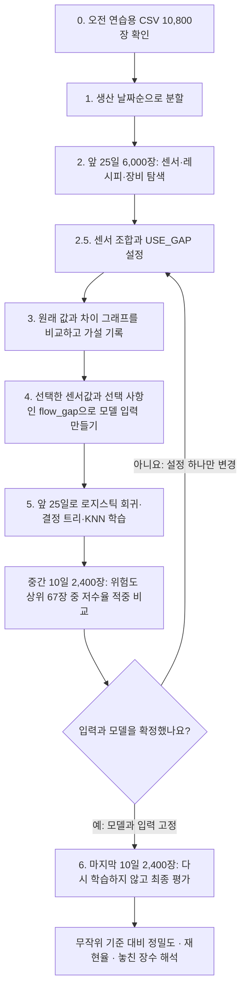

# 인하공전 반도체·AI 해커톤 | v2 웨이퍼 분석

센서의 날짜별 변화에서 가설을 세우고, 제한된 검사 예산에서 실제 저수율 웨이퍼를 더 잘 찾는지 확인하는 45분 Colab 실습입니다.

## 오전 실습

1. [오전 시나리오](Colab_v2_오전_시나리오.md)에서 단계별 활동을 확인합니다.
2. [Colab 준비 가이드](docs/colab/README.md)에 따라 [학생용 노트북](v2_학생용_웨이퍼_분석.ipynb)을 엽니다.
3. [오전 연습용 CSV](해커톤_v2_데이터/data/v2_train_10800.csv)를 내려받아 Colab의 `/content`에 올리고 위에서부터 실행합니다.

오전에는 위험도 상위 67장 중 실제 저수율을 많이 찾는 모델을 우선합니다. 마지막 평가에서는 정밀도뿐 아니라 무작위 기준, 재현율, 놓친 장수도 확인합니다. 오후용 수율 숨김 CSV는 별도로 배포합니다.