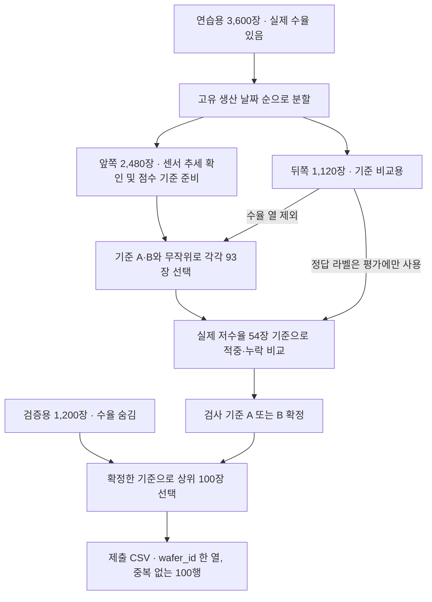

# 인하공전 반도체·AI 해커톤 | 웨이퍼 검사 실습

익명 센서값으로 저수율 웨이퍼를 얼마나 잘 찾아내는지 비교하고, 수율이 숨겨진 1,200장 중 먼저 검사할 100장을 고르는 45분 Colab 실습입니다.

## 실습 시작

1. [Colab 연습 시나리오](Colab_연습_시나리오.md)에서 45분 진행표와 결과 해석 기준을 확인합니다.
2. [통합 실습 노트북](00_wafer_inspection_lab.ipynb)을 Google Colab에서 엽니다.
3. 별도로 배포받은 `연습_3600장.csv`와 `검증_1200장_수율숨김.csv`를 Colab의 `/content`에 업로드하고, 셀을 위에서부터 실행합니다. 로컬에서는 두 파일을 프로젝트의 `student-kit/`에 두고 실행할 수 있습니다. 이 폴더는 Git에서 제외되어 있어 저장소를 내려받아도 CSV는 포함되지 않습니다.

## 데이터 흐름

그림의 장수는 현재 배포 데이터 기준입니다. 저수율은 실제 수율 92% 미만입니다. 센서 점수를 계산할 때는 수율 열을 쓰지 않습니다. 그래프의 점 하나는 웨이퍼 한 장이 아니라 같은 날짜·장비의 센서 중앙값이며, 이 그래프만으로 저수율 원인을 단정할 수 없습니다.

## 제출 파일

노트북 4.3을 실행하면 `outputs/results/검증_우선검사목록.csv`가 생성됩니다. Colab 기본 환경에서는 `/content/outputs/results/`에서 내려받을 수 있습니다. 노트북은 저장한 CSV를 다시 읽어 선택한 ID 목록과 동일한지 확인합니다.