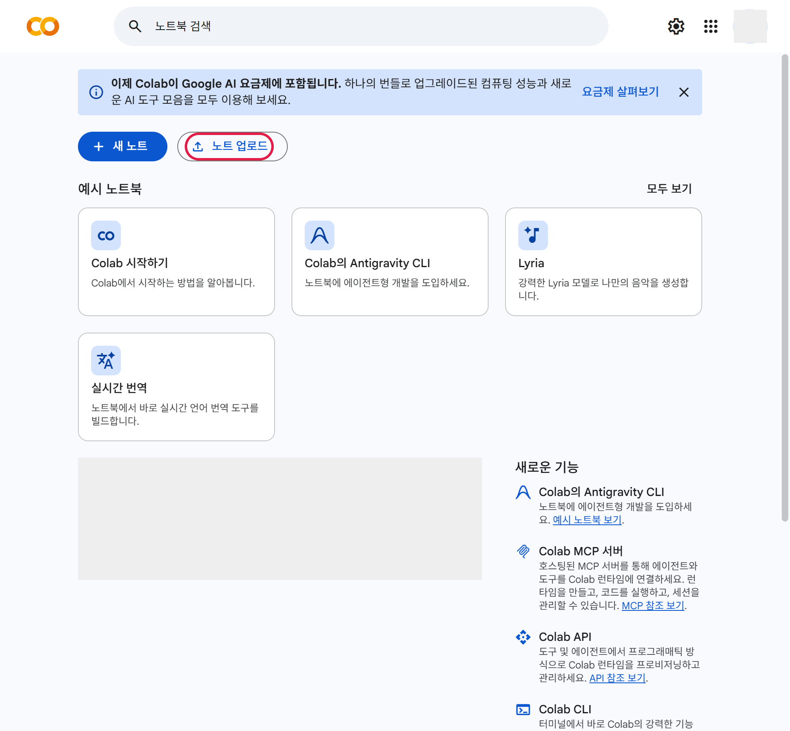
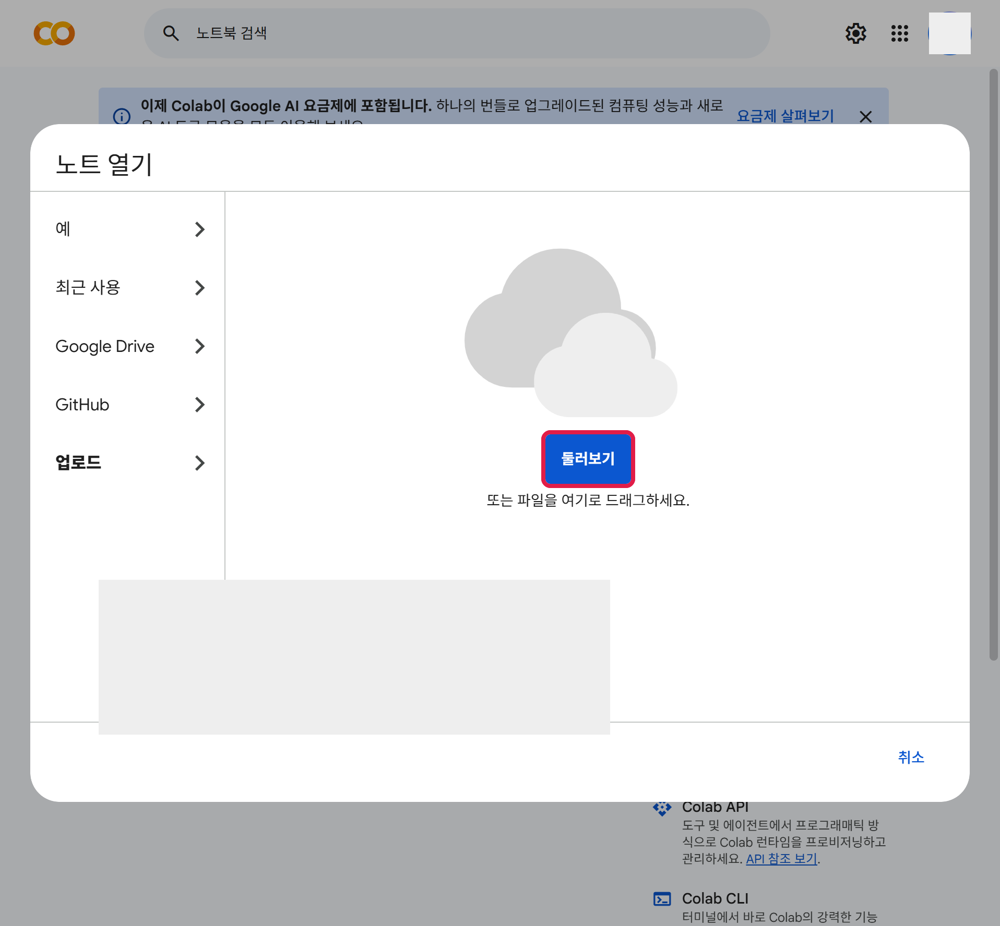
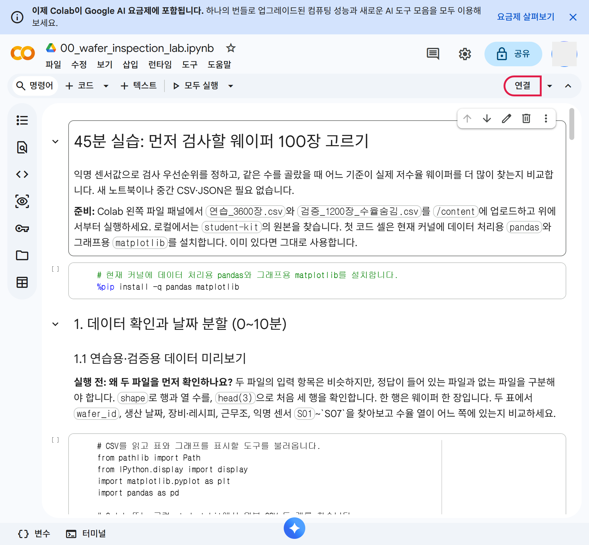
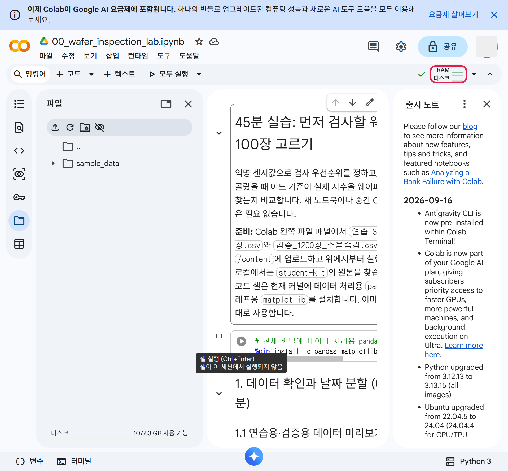
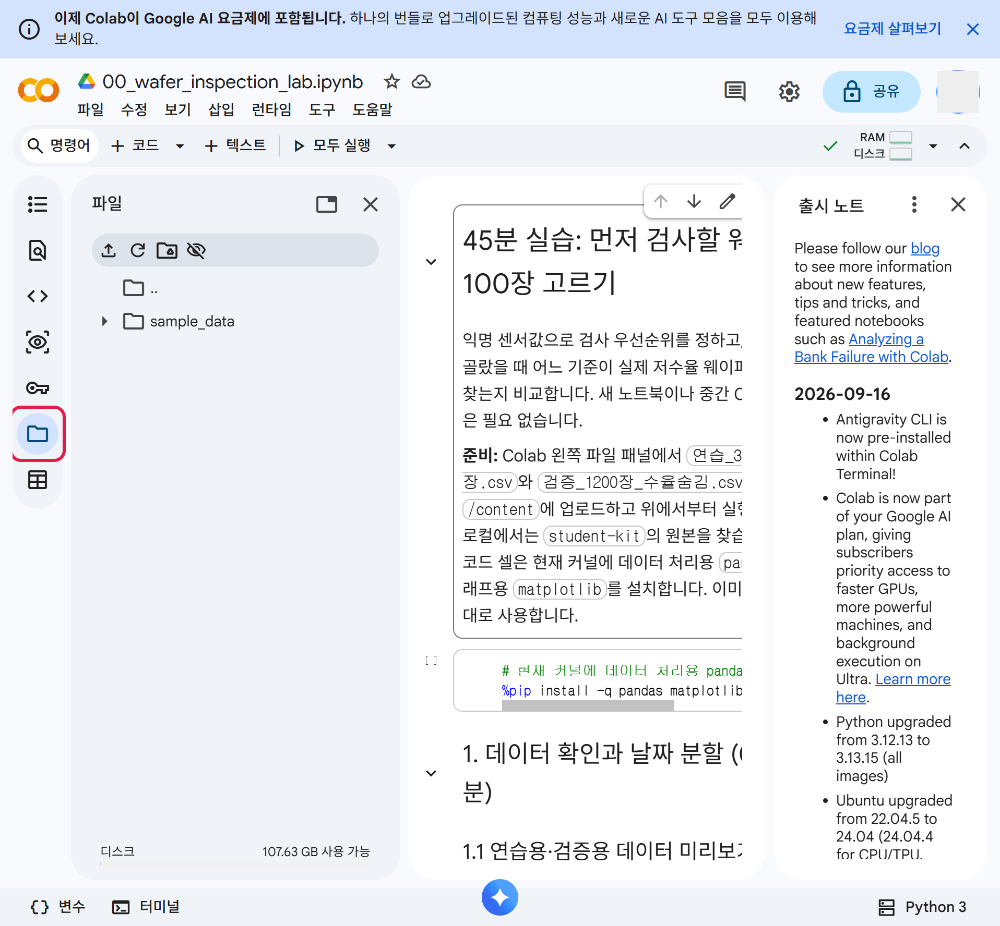
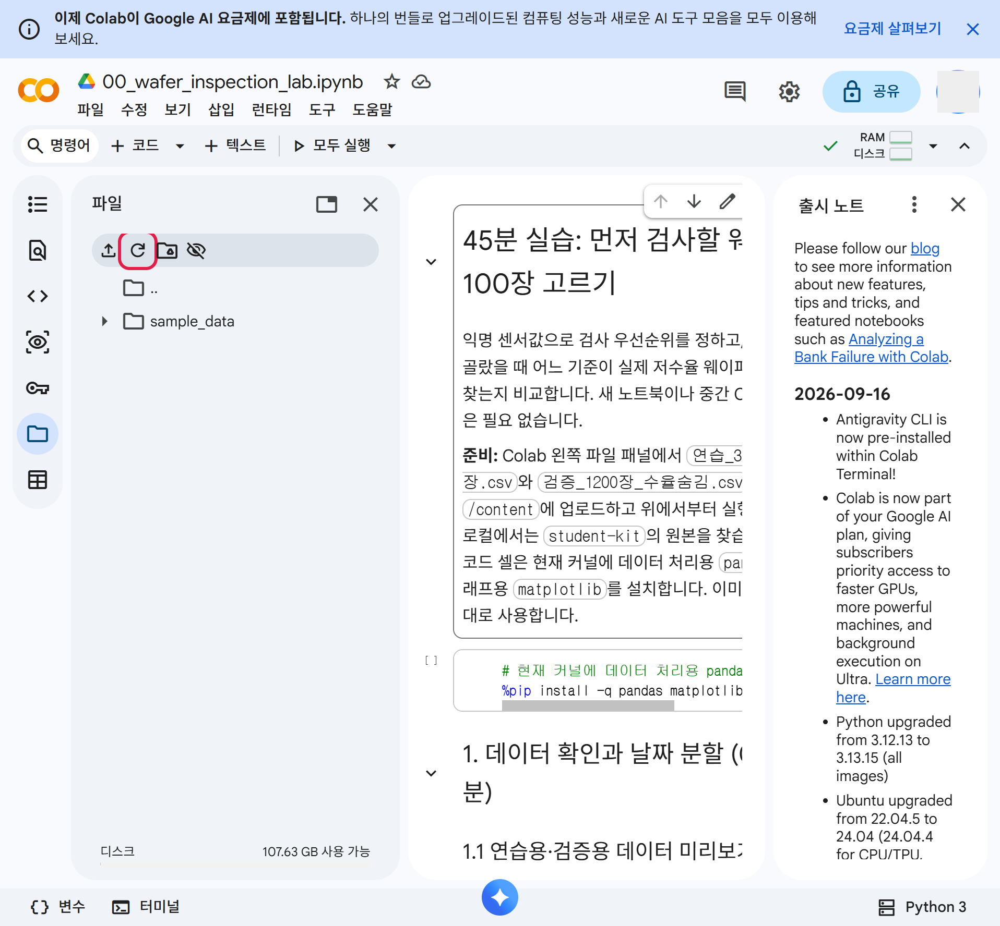
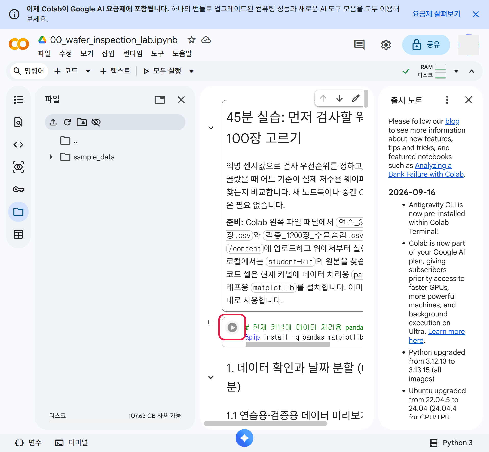

# Colab 실행 준비 가이드

로그인 후 실습 노트북의 첫 코드 셀을 실행하기 직전까지의 안내입니다. 화면이 영어로 보이면 [한국어 Colab 홈](https://colab.research.google.com/?hl=ko)으로 접속하세요.

## 1. 준비 파일 확인하기

- [통합 실습 노트북](../../00_wafer_inspection_lab.ipynb)
- 별도 배포 자료: `연습_3600장.csv`, `검증_1200장_수율숨김.csv`

노트북은 **Colab 홈**, CSV는 **노트북 안의 파일 패널**에 올립니다. CSV는 이 저장소에 포함되지 않으므로 배포 자료에서 먼저 확보하세요.

## 2. 실습 노트북 열기

1. Colab 홈에서 **노트 업로드**를 누릅니다.

   

2. **노트 열기 → 업로드 → 둘러보기**를 누르고 `00_wafer_inspection_lab.ipynb`를 선택합니다. 업로드 영역으로 파일을 끌어다 놓아도 됩니다.

   

3. 편집기가 열리면 상단의 파일 이름과 본문의 **45분 실습: 먼저 검사할 웨이퍼 100장 고르기** 제목을 확인합니다.

## 3. Python 런타임 연결하기

1. 오른쪽 위 **연결**을 누릅니다.

   

2. 연결이 끝나면 **RAM·디스크** 상태가 표시됩니다. 이 실습에는 별도 GPU 설정이 필요하지 않습니다.

   

## 4. CSV 두 개 올리기

1. 왼쪽 사이드바의 폴더 모양 **파일**을 누릅니다.

   

2. 파일 패널 상단의 **세션 저장소에 업로드**를 누르고 두 CSV를 동시에 선택하거나 한 개씩 올립니다. 파일을 패널에 끌어다 놓아도 됩니다.

   

3. 파일 목록에 `연습_3600장.csv`와 `검증_1200장_수율숨김.csv`가 모두 보이는지 확인합니다. 아래 그림은 **업로드 전** 모습입니다. `sample_data` 폴더 안이 아니라 같은 목록에 두 CSV가 보여야 합니다. 파일이 보이지 않으면 패널의 **새로고침**을 누르고, 그래도 없으면 한 개씩 다시 올리세요. 새 런타임으로 바뀌면 CSV를 다시 올려야 합니다.

   

## 5. 첫 코드 셀 실행 준비

두 CSV가 목록에 보이면 본문 위쪽에서 `%pip install -q pandas matplotlib`가 적힌 첫 코드 셀을 찾습니다. 셀 왼쪽의 **▶**가 실행 버튼입니다. 여기까지가 준비 단계입니다. 실습을 시작할 때 이 버튼을 누르고, 설치 셀이 끝나면 **1.1 연습용·검증용 데이터 미리보기** 코드 셀을 실행합니다.

이후 순서와 결과 해석은 [Colab 연습 시나리오](../../Colab_연습_시나리오.md)를 참고하세요.